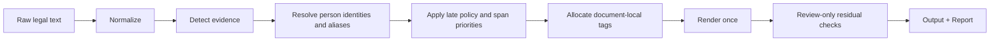

# Architecture

The library is a flat, document-local pipeline for Italian legal decisions. Its main
design choice is to separate evidence collection from output policy: detectors propose
spans, policy resolves every proposal together, and the text is rewritten once.



## Design constraints

1. **Recall is the privacy objective.** An identity counts as removed only when every
   annotated occurrence and alias is gone. A document fails when one identity remains.
2. **One legal pipeline.** General legal cues and layouts are shared across courts;
   archive names never route to separate implementations.
3. **Policy is late and span-local.** Judicial evidence cannot globally veto a surname.
4. **One rewrite.** All offsets are resolved against a stable normalized input before
   rendering, avoiding cascading substitutions and offset drift.
5. **Simple extension points.** The first-name list and optional NER only add person
   seeds; both use the same identity, policy and rendering stages as legal-context
   detectors.
6. **Verification does not mutate.** Residual checks only produce review evidence.

## Pipeline stages

### 1. Normalize

`text.py` applies NFKC normalization, removes zero-width characters, normalizes quotes,
decodes entities, repairs line-wrap hyphenation, strips HTML tags and flattens light
Markdown when `sanitize=True`. Only real tag names are stripped, each tag on one line
and never right after another `<`: the `<<…>>` many judges type as quotation marks is
text, and a generic `<letters…>` pattern used to delete it — together with everything
up to the next `>`, paragraphs away. Detection and replacement offsets refer to this
normalized text, not necessarily the raw input bytes.

### 2. Detect evidence

The runtime has a small set of complementary detectors:

- `patterns.py`: structured PII, legal roles, person cues, party blocks, addresses and
  organization/legal-form patterns;
- `protect.py`: exact judicial-role and procedural-number evidence;
- `seeds.py`: private-person seeds from legal context and the weak first-name list, and,
  on request, the initials a source wrote in place of names;
- `ner.py`: optional transformer person mentions.

Phones and payment cards are the structured identifiers read without a cue word. A phone
is ten digits written as phones are (run together, 3+7, 3-3-4, 2-4-4…) or any number with
a `+` country prefix; a card is sixteen digits, run together or in groups of four. Both
stay when an identifier word comes first (`n.`, `cartella`, `voce doganale`, `EUR`…), and a
phone also when it starts with `00`, because tax decisions are full of ten- and
sixteen-digit act, tariff and register numbers and none is a phone or a card. A year list
(`2006-2007-2008-2009`) is no card either.

None of these modules edits text or decides that an identity is globally safe. Private
companies are detected even when the default policy later declines to redact them.

### 3. Resolve document-local people

`SeedSet` merges order-insensitive full identities and their observed variants. Once a
person is established, `variant_patterns` proposes:

- exact and case-insensitive full spellings, whose words are separated by spaces or one line
  break, never a blank line (the end of one paragraph and the start of the next are not a
  name);
- common surname-first/given-name-first rotations;
- bare tokens only when they are long and absent from the legal common-word list.

Strong private-role cues may seed an exact all-common name such as `Antonio De Luca`,
but it contributes no unsafe bare-token propagation. When a token belongs to more than
one detected person, the token is still redacted under a neutral identity instead of
being assigned arbitrarily.

The bundled first-name list covers names registered in Italy and is intentionally used
as weak evidence. One linear token scan proposes only adjacent full names: ordinary
`Given Surname`, or the ALL-CAPS `SURNAME GIVEN` form used in headings. Across a line
break the two tokens must share a case style and the next line must read as the rest of
the name, and a name inside a street, a saint's or a town's (`Viale Pietro
Pietramellara`, `San Giorgio`, `Vittorio Veneto`) is refused. A listed first name alone
is a seed only after a salutation or a kinship cue (`Caro Paolo,`, `il figlio minore
Tommaso`), and folds into the one full name it belongs to. A common first name of a
detected person (`Paolo` of `Paolo Gennari`) is then proposed case-sensitively, only when
one detected person owns it, never after a street word or a saint and never next to
another name token. Legal common words, public institutions and company suffixes remain
guards, and the resulting identity follows the normal alias and late-policy path. The
JSON resource is loaded once on first use; `Config(first_names=False)` turns the scan
off.

Party blocks are read as lists. After an applicant cue (`proposto da`, `ricorso di`) or
a counter-party cue (`nei confronti di`, or `nei confronti` or `contro` ending its line,
as the administrative and civil headings print them), or the civil `vertente tra`, which
names both sides and so gives no side to its names, every name of a list separated by
commas, semicolons or `e` is seeded, not only the first: a mass appeal lists dozens of
applicants after one cue. The cue's preposition may come back before the last name
(`proposto da A e da B`, `nei confronti di A e di B`); a new cue (`e nei confronti di B`)
starts the other side. The list ends at the first item that is not name-shaped, and
institutions inside it are left to the public-body guards. A name followed by
`rappresentato e difeso` is a party as well. Companies and public bodies stand in the
same places, so a hit from these cues is refused when the text continues it into an
organisation: a legal form after it (`… S.r.l.`), or a capitalised word and a
preposition before it (`Comune di …`).

Court text wraps names, so a few anchors read a name across a line break (counsel,
`difeso da`, the codice fiscale's neighbour, the signature block, NER mentions). Past the
break the capture keeps the next line only if it reads as the rest of the name: no
common word unless a listed first name, no heading or role word, no field label after
it. Otherwise `Giudice: avv. Biagio Stomeo⏎Segretario: …` became one person and the
rewrite deleted the label and the break. Lists of counsel or parties may wrap but end at
a blank line, and a phone number stays on its line.

A person named by surname alone is read after a title or a role: `il sig. Malaspina`, `il
geometra Brambillasca` (`TITOLO_SOLO`), `il ricorrente Malaspina` (`PARTY_ROLE_SOLO`), and
`il notaio`, `il perito`, `il teste`, `la socia`, `gli eredi` and the other capacities of a
case (`ROLE_SOLO`). The word after a role is an adjective of it as often as a name
(`l'Amministratore Unico`, `il Curatore Speciale`), so those are refused, and the common-word
guard still refuses `Casa` or `Rigetto`. Two or more capitalised words after a title or role
are a full name, which the patterns above already read. `dott.` and `prof.` are left out of
the surname rule, since judges carry them; the review step reports them instead (step 6).
A surname known only from these cues is hunted in every case but lower case: `il socio
Sanitari` does not take `servizi sanitari` with it, and OCR damage (`bRAMBILLASCA`) is still found.

Some sources have already shortened their parties to initials (`A.G. e S.I.`). With
`initials=True` they are read as names are: only behind a cue (those of `PROPOSTO_DA`,
`NEI_CONFRONTI`, `PARTY_ROLE`, `COUNSEL`, `TITOLO`, `QUALIFICA` and `BIOGRAFICO`, plus the
penal parties), then wherever else the same letters recur in the document. The shape is
two or three capitals with their dots: four letters are a sigla far more often than a
person, and `C.F. L` or `I.A.c.p.` are no initials at all. Exclusions beat evidence: a
sigla of `resources/sigle.json` (`P.Q.M.`, `C.T.U.`, `D.L.`), a reference (`art. 2697 C.C.`,
`D.L. n. 78`, any number before or after), a judicial role right before (`Presidente dott.
N.A.`), an organisation (the `_in_organisation` test: `R.B. s.p.a.`) and a surname in clear
after them (`G.M. Nonno`). A person whose initials are those of a listed sigla stays in
clear: that is the price of never turning `P.Q.M.` into a party. `initials="all"` drops
the cue for a source known to write its parties that way and keeps every exclusion. The
candidates are ordinary person candidates, so judges, overlaps and tags go through the
usual policy; the tag is allocated per initials, so `A. G.` and `A.G.` are one person.

### 4. Apply policy and resolve overlaps

`policy.py` filters candidates using `Config`, then greedily accepts non-overlapping
spans by evidence priority and length:

| Priority | Evidence |
|---:|---|
| 200 | complete expressions supplied in the review state |
| 120 | structured personal data |
| 100 | full person names kept by choice or role policy, and procedural references |
| 40 | cued or letterhead address, birthplace or residence town |
| 35 | private company |
| 30 | full person identity |
| 20 | distinctive or ambiguous person token |

A request to redact a substring of a structured identifier preserves the complete
identifier redaction and raises a review warning. A literal matching the whole
identifier can provide its own label.

Structured PII deliberately outranks kept case identifiers, so a birth date such as
`12/03/1974` cannot survive because a substring resembles a case number.

For company candidates, `companies=False` keeps every company,
`companies="person_named"` accepts only candidates with a conservative family-name
signal, and `companies=True` accepts them all; public-institution guards apply before
this choice. Accepted company spans outrank person
aliases so a surname shared with a partner or shareholder does not leave part of the
company name visible.

With `keep_roles=("giudice",)`, the engine keeps full spellings of judges. A short
alias can still be redacted. An ambiguous surname shared by several known people
receives a neutral tag. A keep that falls inside a longer confirmed private name yields
to the full redaction and produces a warning. For example:

```text
Presidente: ROSSI MARIO       -> kept
ROSSI LUCIA, ricorrente       -> redacted
La Rossi insiste              -> redacted
```

A European case's name is protected the same way, as part of its citation:
`Scoppola c. Italia` and `C-348/16, Sacko` stay, while a party called Scoppola elsewhere in
the decision is still replaced.

If one complete identity has both judicial and strong private-role evidence, the
privacy-first conflict rule removes its occurrences and emits a warning. A broad party
window alone is not strong enough to revoke an explicit judicial role, because legal
headers can contain prosecutors inside that window.

Judicial names from bench lists and role cues enter the same full-name matcher
as other people. The role remains `giudice` when retention is disabled. A courtesy
title alone does not give a person a judicial or private role. Automatic role
recognition depends on the detector cues. Contract roles in the registry can also
be supplied as metadata.

`keep_case_numbers=False` removes the citation keep decision. Public institutions,
in the plural as well (`le Regioni`, `le Province`), and regions or the parts of their names
(`Alto Adige`, `Friuli`) are rejected as person/company candidates. A place is proposed only in a biographic
slot ("nato a Stia", "residente a Pratovecchio") and only if ISTAT lists it as a comune, current or suppressed, or, for a
birthplace, when its country follows in brackets (`nato a Wenzhou (Repubblica Popolare
Cinese)`); a court seat or any other mention of a town is never a candidate.

An address is proposed after a personal cue (residence, domicile, `con studio in`, a
property `sito in`) or as the address line of a letterhead, a signature or an addressee
block. A block that names a public body or a company is theirs and stays, as do a
registered office (`con sede in`), the Avvocatura's domicile, a statutory domicile at the
court, and a property cue right after a public body. A public office's mailbox (an
address on a public administration's domain with no first name in it, such as
`dp.treviso@pce.agenziaentrate.it`) is not personal data and is not proposed either.

### 5. Allocate tags and render once

Each accepted entity gets a document-local ID. A redaction also gets a placeholder.
The state reserves existing IDs and placeholders before allocating new ones. A
placeholder can be any nonempty string. Its prefix is never used to infer a type.
After applying anchored exceptions, `_render` joins untouched slices and final
replacements in one pass.

`Report.state` is the record of a run, and `Report.decisions` the complete list of
substitutions and offsets. `Report.mapping` is only a summary for reading, derived from
the decisions: each original value replaced in this revision with its tag, one entry
per entity. A value given two tags (two individually redacted copies) is left out.

### 6. Verify without rewriting

`verification.py` scans returned output for:

- structured identifiers;
- strong private-role cues;
- known aliases selected for redaction;
- broad 2–4-token capitalized name candidates;
- a capitalised word after a title or trade (`sig.`, `avv.`, `geometra`, `notaio`, `dott.`,
  `prof.`);
- role conflicts;
- long documents with no detections.

Only a person finding wholly contained in an accepted public-role span is exempt.
Structured PII is never suppressed merely because it overlaps a kept span.

The name-shape scan cannot tell a name from a heading, so it drops a phrase only when the
phrase *as a whole* cannot be a person, never because of the words around it: it is made
only of articles, prepositions, titles, roles and heading words (`Il Presidente`, `Sezione
Terza`, `IN NOME DEL POPOLO`); a legal form follows it, so it is a company, which stays by
default; or it is a comune that does not open with a first name (`Reggio Calabria`, but
not `Alice Castello`). A phrase that opens with a surname particle and ends in a plain
word (`Del Giudice`) is kept, and so are the words `giudice` and any first name. On the 159
evaluation documents these rules remove 42% of the name-shape findings (683 to 393) and none that sits
on an annotated leak.

A word after a title is a name nine times out of ten, and the patterns that replace it may
have refused it: a common word used as a surname (`avv. Casa`), a first name alone. The
review step reports it, unless it is an adjective of a role (`l'Avvocato Generale`) or
something says that a judge is meant, whom a published decision keeps in clear: a judicial role right
before the title, right after the name, or alone on the line above or below; and, for
`dott.`, `dr.` and `prof.`, a word of the name that a kept judge also has. On the 159
evaluation documents it adds four findings, three of them on annotated leaks.

The scan is deliberately broad: on the current evaluation it flags almost every annotated
leaking document, and produces many false review alarms. A document whose only leak is a
bare surname can end with no finding at all. `passed_checks` consequently
means “no bundled heuristic fired,” not “anonymous” or “safe to publish.” Running a
second transformer pass would add cost without independent evidence, so verification
does not do that.

## Shared data and report contract

`model.py` holds immutable or small shared records:

- `Mention`: one detector observation;
- `Entity`: one document-local person and its variants/sources;
- `Candidate`: a proposed span before policy;
- `Decision`: an accepted keep/redact action;
- `EntityRecord`: compact grouped audit data;
- `ResidualFinding` and `Verification`: output-review evidence.

The public call remains:

```python
output, report = anonymize(text, config=None, state=None, **overrides)
```

The first five `Report` fields retain positional compatibility:
`mapping`, `protected`, `replacements`, `replacement_spans`, `risk`. New audit fields
are additive and recursively JSON serializable.

Coordinate spaces are explicit:

- `replacement_spans`, `decisions`: `normalized_input`;
- `residuals`: `output`.

Input offsets count Unicode characters in `Analysis.text`. With `sanitize=False`,
the engine skips markup cleanup and still normalizes quotation marks.

### Document state and replay

Both `analyze` and `anonymize` take `state=`. The returned state is an ordinary
dictionary with three editable lists and an optional discovery revision. The public contract and worked examples are in
[the API specification](API_SPEC.md).

1. `constraints.ReviewState` copies and validates the input. People are matched by
   normalized name, data by normalized value. Their stable `id` is independent of
   both wording and placeholder. Duplicate IDs, ambiguous placeholder ownership,
   and unknown occurrence targets are rejected before analysis.
2. An unconstrained first pass records `discovery_revision`, a SHA-256 digest of
   its normalized source. On that revision the engine reconstructs its automatic
   proposals from current detector evidence. Only added or changed matching
   rules enter the broader matcher. IDs and placeholders always apply during
   allocation. This preserves the original spans on an unedited round trip and
   when a reviewer changes only a label. Native person seeds, including optional
   NER results, are collected once per call.
3. On a different revision, or with hand-written state that omits the digest,
   all supplied rows act as matching rules. Supplied people enter ordinary person detection. Saved values and aliases also
   match complete expressions without a detection cue. Missing roles and types
   use the engine's vocabulary in `labels.ROLE_PREFIXES` and `DATA_PREFIXES`.
   A missing person action follows `Config.keep_roles` (empty by default).
   A submitted action persists across changes in configuration.
4. Each accepted document-wide match completes an entity row. Absence retains a
   submitted row and its tag. Newly detected entities receive unused IDs and tags.
   An automatically detected row and a caller-supplied row have the same meaning
   on replay. Weak name fragments remain subject to the person matcher's guards.
5. Occurrence choices apply to the current revision after document-wide decisions.
   A linked redaction uses the referenced entity's tag. An independent redaction
   keeps its placeholder on the occurrence itself. Overlapping exceptions,
   selections that cut through a longer match, and anchors with no unique match
   are returned in `report.unresolved`. Verification flags them for review.
   A document-wide keep acknowledges the matching value. A passage keep may
   still attract a verification finding, which a separate dismissal can acknowledge.

A UI can convert a selection in normalized source text into a portable anchor:

```python
from dataclasses import asdict
from pseudonimizzatore_legale import TextAnchor, analyze, anonymize

first = analyze("Codice: zefiro.")
start = first.text.index("zefiro")
anchor = TextAnchor.capture(first.text, start, start + len("zefiro"))
first.state["occurrences"].append({"action": "redact", "anchor": asdict(anchor)})
output, report = anonymize("Nota.\nCodice: zefiro.", state=first.state)
assert output == "Nota.\nCodice: Dato_1."
```

Save the state with `json.dumps(report.state)` and pass the decoded dictionary
back with the current source. It contains original names, values, and excerpts.
Report schema 4 includes the discovery revision. Older JSON state with the three
collections remains valid as ordinary document-wide input. The report’s
`entity_records` group the current decisions by document identity and can show
a mixed outcome when a passage overrides the entity default.

## Batch safety

`batch.py` uses independent worker processes because no identity state crosses document
boundaries. It rejects overlapping source/destination trees and in-place file writes,
decodes UTF-8 strictly, and returns errors per file.

Output and sidecar writes use same-directory temporary files followed by atomic
replacement. Symbolic links in destination paths are rejected.

Resume is opt-in. Optional mapping sidecars include source and output SHA-256 values,
the JSON-shaped configuration, engine version and report schema. A sidecar-backed
output is skipped only when all five still match. Explicit resume without a sidecar is
based only on output existence and is counted as unvalidated in the summary. Sidecars
contain original PII and are excluded by `.gitignore`.

## Restoring the originals

`restore.py` stands outside the pipeline. It reads only the state, never the source,
and runs no detector: the text it receives was written by someone else, usually a
language model, and only the tags in it are known. Each tag maps to one original, so
a person tagged from several surface forms comes back as one spelling. A tag is read
as a whole word, in any case and with Markdown's `\_`. A tag-shaped word the state
does not know is reported, not guessed.

## Why there is no document router

Court-specific routers tend to turn every new archive into another pipeline with its
own bugs and metrics. This library instead models structures that recur across Italian
decisions: role cues, bench lists, party blocks, biographic clauses, counsel lists,
public institutions and procedural identifiers. A pattern is added only when it
describes a reusable legal-text structure and has positive and negative tests.

`profile="query"` is only a performance shortcut that omits the long block scan. The
legacy `cassazione` and `generic` names normalize to `legal` and have no behavioral
branches.

A broader non-legal mode is intentionally not another profile yet. Its removal policy
and false-positive budget need a separately annotated general-Italian corpus first;
adding that branch before it can be measured would create operational complexity with
no defensible default.

## Optional NER and future training

NER emits `Mention` records and stops there. The common identity and policy layers are
what keep regex and model behavior auditable and comparable. An ensemble is simply the
union of mentions from several backends.

Custom-model training is intentionally paused. A future synthetic-data model should be
introduced as another `NerBackend`, benchmarked on complete-entity recall, complete
documents, protected-value survival and replacement precision, and should not create a
parallel anonymization pipeline.

## Known limitations

- Deterministic person recall remains weakest in low-structure civil and EU material.
- Optional NER improves recall but may remove uncued public-role aliases; exact role
  spans remain protected.
- A party list ends at the first item that is not name-shaped, and a name no cue
  introduces ("motivi aggiunti presentati da X") stays in clear unless it is also
  seen in a cued position.
- Review findings have high recall and low precision and therefore require triage.
- The evaluation corpus is useful but small (124 documents) and not a legal guarantee.
- PDF/OCR extraction quality is outside the package; malformed text can still hide PII.

See [`evaluation/RECALL_BENCHMARK.md`](evaluation/RECALL_BENCHMARK.md) for current
numbers and reproduction commands.
